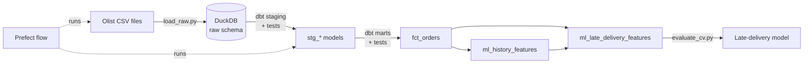

# Olist order-to-decision pipeline

End-to-end analytics on 99,441 real e-commerce orders from Olist, a Brazilian marketplace: from raw CSV files to a tested data warehouse, then to delivery-risk and demand models, inventory decisions and a served API.

**Business question:** Which orders are at risk of arriving late, how much will each product category sell in the coming weeks, and how much stock should be held?

## Status

| Module | Content | Status |
|---|---|---|
| 1. Data pipeline | DuckDB warehouse, dbt models with tests, Prefect orchestration | ✅ Done |
| 2. Models | Late-delivery classifier, weekly demand forecast with prediction intervals | ✅ Done |
| 3. Inventory simulation | Monte Carlo safety stock and service levels | Planned |
| 4. Experiment analysis | A/B test analysis on a public mobile-game dataset | Planned |
| 5. Serving and monitoring | FastAPI in Docker, drift check, dashboard | Planned |

## Architecture



- **Load:** `scripts/load_raw.py` copies the 9 CSV files unchanged into DuckDB's `raw` schema.
- **Transform:** dbt staging models rename columns, set types and fix source spelling errors. Marts join them into one row per order (`fct_orders`) and into model-ready feature tables.
- **Test:** 29 dbt tests check unique and non-null keys, valid order statuses and referential integrity.
- **Orchestrate:** `scripts/pipeline.py` runs load, then build, as one Prefect flow with retries and per-task logs.
- **Model:** `ml/evaluate_cv.py` compares models and feature sets with time-based cross-validation.

## Findings from the data

- **8.1% of delivered orders arrived late** (7,826 of 96,470 orders with a delivery date), measured as delivery after the estimated date shown to the customer.
- **Lateness swings strongly over time:** from 1.4% of orders (June 2018) to 21.4% (March 2018). November 2017 (14.3%) coincides with the year's largest order volume; February–March 2018 (16–21%) had normal volume, so the cause was operational, not demand.
- **About 3% of orders were never delivered.** They stay in the data but are excluded from the late-delivery target.
- **The business grew about ninefold in one year:** from 750 delivered orders in January 2017 to 7,069 in January 2018. Forecasts therefore weight recent weeks over early 2017.
- **Repeat buying is rare:** 2,997 of 96,096 customers (3.1%) placed more than one order. Olist creates a new `customer_id` for every order, so customers are counted with `customer_unique_id`.
- **Coverage:** orders from Sep 2016 to Oct 2018. The data is sparse before January 2017.

## Late-delivery model

**Goal:** at the moment of purchase, rank orders by their risk of arriving late, so an operations team can check the riskiest ones first.

**Leakage rule:** a feature may only use information available at checkout. Delivery dates and review scores are excluded, since both exist only after delivery. History features are computed *as of* the purchase: only orders already delivered before that moment count.

**Validation:** time-based cross-validation with three consecutive test periods (Sep 2017 – Aug 2018); each model trains only on earlier orders. Because the late rate differs by period (6.3% to 13.2%), results are reported as **lift**: PR-AUC divided by the period's late rate, i.e. how many times better than random. The decision rule was fixed before testing: a change is kept only if it improves results in all three periods; mixed results favour the simpler model.

| Model | Features | Mean lift | Riskiest 10% captures |
|---|---|---|---|
| Logistic regression | base, with purchase month | 1.76× | 20.5% of late orders |
| **Logistic regression** | **base, without purchase month** | **1.88×** | **22.2% of late orders** |
| Logistic regression | + seller history | 1.81× | 21.6% |
| Logistic regression | + seller history + recent delivery conditions | 1.96× | 22.8% |
| Gradient boosting | base, with purchase month | 1.80× | 21.3% |
| Gradient boosting | + seller history + recent delivery conditions | 1.53× | 18.4% |

**Final model: logistic regression, base features, without purchase month.** Flagging the riskiest 10% of orders captures 22% of late deliveries, about 2.2 times better than random.

**What did not work, and why:**
- **Purchase month** let the model memorise one exceptionally bad March instead of learning a real seasonal pattern; removing it improved two of three periods.
- **Seller history** (a seller's late rate on earlier delivered orders) lowered results in all three periods. Most sellers have few past orders, so their rates are noisy.
- **Recent delivery conditions** (late rate of orders delivered in the 14 days before purchase) lag reality by about a month, because late orders reveal their lateness only when they finally arrive. Results were mixed, so the feature was not kept.
- **Gradient boosting** did not beat logistic regression consistently and degraded with history features, which act like a hidden calendar it can memorise.

**What I would try next:** smoothing seller late rates toward the overall average for sellers with little history; carrier or route information, which the dataset does not contain.

## Weekly demand forecast

**Goal:** forecast units ordered per week for the 10 largest product categories, 4 weeks ahead, with a range that inventory planning can use.

**Data:** `mart_weekly_category_demand` holds one row per week and category, built on a generated calendar (Jan 2017 – Aug 2018, 85 weeks, 72 categories) so weeks without sales appear as 0 instead of going missing. The incomplete final week is excluded, and a dbt test fails if any week is missing.

**Evaluation:** rolling origin: from each of 16 weeks (Apr – Aug 2018), forecast the next 4 weeks using only earlier data, then compare with actual demand. Scored with WAPE (total absolute error ÷ total actual units).

| Method | WAPE |
|---|---|
| Naive (last week) | 31.2% |
| **Mean of last 4 weeks** | **27.6%** |
| Mean of last 8 weeks | 27.7% |
| Mean of last 12 weeks | 28.5% |

**Chosen forecast: mean of the last 4 weeks**, tied for best and the quickest to follow a growing business.

**Prediction intervals:** the ratio of actual to forecast demand was measured on an earlier calibration period (origins from late Nov 2017). Its 10th and 90th percentiles (0.52 and 1.55) give an 80% interval of forecast × 0.52 to forecast × 1.55. On the later, unseen test period, **84.1% of actual values fell inside the interval** (target 80%), so the interval is honest and slightly conservative. Example: `bed_bath_table` is forecast at about 189 units per week, with an 80% interval of 99 to 292.

**Interpretation:** weekly category demand is noisy, so even the best simple method misses by about 28% of actual demand. The range matters more than the single number, and the inventory simulation (module 3) is built on it.

**What I would try next:** exponential smoothing or a gradient-boosting model on lagged demand, kept only if it beats the 27.6% WAPE baseline across the rolling evaluation; category-specific intervals instead of one shared set of multipliers.

## How to run

Requires Python 3.12 on Windows, macOS or Linux.

```bash
git clone https://github.com/muhammedmufad/olist-order-to-decision.git
cd olist-order-to-decision
python -m venv .venv
# Windows: .\.venv\Scripts\Activate.ps1    macOS/Linux: source .venv/bin/activate
pip install -r requirements.txt
```

1. Download the "Brazilian E-Commerce Public Dataset by Olist" from Kaggle and extract the 9 CSV files into `data/raw/`.
2. Build the warehouse and run all data tests:

```bash
python scripts/pipeline.py
```

3. Reproduce the model comparison (takes several minutes):

```bash
python ml/evaluate_cv.py
```

4. Reproduce the demand forecast evaluation and prediction intervals:

```bash
python ml/forecast_baselines.py
python ml/forecast_intervals.py
```

## Project structure

```
├── data/raw/              # Olist CSVs (not in the repo)
├── warehouse/             # DuckDB database file (not in the repo)
├── scripts/
│   ├── load_raw.py        # CSVs into the raw schema
│   ├── pipeline.py        # Prefect flow: load, then dbt build
│   └── explore_tables.py  # sample rows and one order traced across tables
├── dbt/
│   └── models/
│       ├── staging/       # one cleaned model per source table, with tests
│       └── marts/         # fct_orders, history features, model features
└── ml/
    ├── train_late_delivery.py  # feature loading and a single time-split baseline
    └── evaluate_cv.py          # time-based cross-validation of models and feature sets
    ├── forecast_baselines.py   # rolling evaluation of simple weekly demand forecasts
    └── forecast_intervals.py   # calibrated 80% prediction intervals
```

## Data

Brazilian E-Commerce Public Dataset by Olist, published on Kaggle. The data is not redistributed in this repository; see the Kaggle page for its license.

## Limitations

- Orders bought near the end of the data that would have been late may not have been delivered before the data was cut, so recent periods may understate lateness.
- Lateness depends strongly on time-period conditions that purchase-time features cannot see, which caps how well any order-level model can perform.
- Package versions in `requirements.txt` are not yet pinned.
- The data covers 2016–2018 and one marketplace, so findings describe that context only.
- Prediction intervals use one shared set of multipliers for all categories; smaller categories are relatively noisier than this assumes.