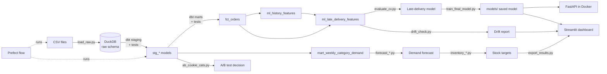

# Olist order-to-decision pipeline

**[Live demo](https://olist-order-to-decision.streamlit.app/)** · score an order's late-delivery risk, explore demand forecasts and stock targets, and see the drift monitor.

End-to-end analytics on 99,441 real e-commerce orders from Olist, a Brazilian marketplace: from raw CSV files to a tested data warehouse, then to delivery-risk and demand models, inventory decisions, a containerised prediction API, drift monitoring and a live dashboard. A separate module analyses a public A/B test.

**Business question:** Which orders are at risk of arriving late, how much will each product category sell in the coming weeks, and how much stock should be held?

## Status

| Module | Content | Status |
|---|---|---|
| 1. Data pipeline | DuckDB warehouse, dbt models with tests, Prefect orchestration | ✅ Done |
| 2. Models | Late-delivery classifier, weekly demand forecast with prediction intervals | ✅ Done |
| 3. Inventory simulation | Monte Carlo safety stock and service levels | ✅ Done |
| 4. Experiment analysis | A/B test on a public mobile-game dataset (Cookie Cats) | ✅ Done |
| 5. Serving and monitoring | FastAPI in Docker, automated tests, drift check, live dashboard | ✅ Done |

## Architecture



- **Load:** `scripts/load_raw.py` copies every CSV file in `data/raw/` unchanged into DuckDB's `raw` schema.
- **Transform:** dbt staging models rename columns, set types and fix source spelling errors. Marts join them into one row per order (`fct_orders`), model-ready feature tables and weekly demand per category.
- **Test:** 38 dbt tests check unique and non-null keys, valid order statuses and experiment variants, referential integrity, and that no week is missing from the demand calendar. 6 pytest tests check the API.
- **Orchestrate:** `scripts/pipeline.py` runs load, then build, as one Prefect flow with retries and per-task logs.
- **Model and decide:** scripts in `ml/` evaluate the late-delivery model, the demand forecast, the inventory simulation and the A/B test.
- **Serve and monitor:** the final model is saved to `models/`, served by a FastAPI service in Docker, checked for drift, and shown in a Streamlit dashboard.

## Findings from the data

- **8.1% of delivered orders arrived late** (7,826 of 96,470 orders with a delivery date), measured as delivery after the estimated date shown to the customer.
- **Lateness swings strongly over time:** from 1.4% of orders (June 2018) to 21.4% (March 2018). November 2017 (14.3%) coincides with the year's largest order volume; February–March 2018 (16–21%) had normal volume, so the cause was operational, not demand.
- **About 3% of orders were never delivered.** They stay in the data but are excluded from the late-delivery target.
- **The business grew about ninefold in one year:** from 750 delivered orders in January 2017 to 7,069 in January 2018. Forecasts therefore weight recent weeks over early 2017.
- **Repeat buying is rare:** 2,997 of 96,096 customers (3.1%) placed more than one order. Olist creates a new `customer_id` for every order, so customers are counted with `customer_unique_id`.
- **Coverage:** orders from Sep 2016 to Oct 2018. The data is sparse before January 2017.

## Late-delivery model

**Goal:** at the moment of purchase, rank orders by their risk of arriving late, so an operations team can check the riskiest ones first.

**Leakage rule:** a feature may only use information available at checkout. Delivery dates and review scores are excluded, since both exist only after delivery. History features are computed *as of* the purchase: only orders already delivered before that moment count.

**Validation:** time-based cross-validation with three consecutive test periods (Sep 2017 – Aug 2018); each model trains only on earlier orders. Because the late rate differs by period (6.3% to 13.2%), results are reported as **lift**: PR-AUC divided by the period's late rate, i.e. how many times better than random. The decision rule was fixed before testing: a change is kept only if it improves results in all three periods; mixed results favour the simpler model.

| Model | Features | Mean lift | Riskiest 10% captures |
|---|---|---|---|
| Logistic regression | base, with purchase month | 1.76× | 20.5% of late orders |
| **Logistic regression** | **base, without purchase month** | **1.88×** | **22.2% of late orders** |
| Logistic regression | + seller history | 1.81× | 21.6% |
| Logistic regression | + seller history + recent delivery conditions | 1.96× | 22.8% |
| Gradient boosting | base, with purchase month | 1.80× | 21.3% |
| Gradient boosting | + seller history + recent delivery conditions | 1.53× | 18.4% |

**Final model: logistic regression, base features, without purchase month.** Flagging the riskiest 10% of orders captures 22% of late deliveries, about 2.2 times better than random.

**What did not work, and why:**
- **Purchase month** let the model memorise one exceptionally bad March instead of learning a real seasonal pattern; removing it improved two of three periods.
- **Seller history** (a seller's late rate on earlier delivered orders) lowered results in all three periods. Most sellers have few past orders, so their rates are noisy.
- **Recent delivery conditions** (late rate of orders delivered in the 14 days before purchase) lag reality by about a month, because late orders reveal their lateness only when they finally arrive. Results were mixed, so the feature was not kept.
- **Gradient boosting** did not beat logistic regression consistently and degraded with history features, which act like a hidden calendar it can memorise.

## Weekly demand forecast

**Goal:** forecast units ordered per week for the 10 largest product categories, 4 weeks ahead, with a range that inventory planning can use.

**Data:** `mart_weekly_category_demand` holds one row per week and category, built on a generated calendar (Jan 2017 – Aug 2018, 85 weeks, 72 categories) so weeks without sales appear as 0 instead of going missing. The incomplete final week is excluded, and a dbt test fails if any week is missing.

**Evaluation:** rolling origin: from each of 16 weeks (Apr – Aug 2018), forecast the next 4 weeks using only earlier data, then compare with actual demand. Scored with WAPE (total absolute error ÷ total actual units).

| Method | WAPE |
|---|---|
| Naive (last week) | 31.2% |
| **Mean of last 4 weeks** | **27.6%** |
| Mean of last 8 weeks | 27.7% |
| Mean of last 12 weeks | 28.5% |

**Chosen forecast: mean of the last 4 weeks**, tied for best and the quickest to follow a growing business.

**Prediction intervals:** the ratio of actual to forecast demand was measured on an earlier calibration period (origins from late Nov 2017). Its 10th and 90th percentiles (0.52 and 1.55) give an 80% interval of forecast × 0.52 to forecast × 1.55. On the later, unseen test period, **84.1% of actual values fell inside the interval** (target 80%), so the interval is honest and slightly conservative. Example: `bed_bath_table` is forecast at about 189 units per week, with an 80% interval of 99 to 292.

**Interpretation:** weekly category demand is noisy, so even the best simple method misses by about 28% of actual demand. The range matters more than the single number, and the inventory simulation is built on it.

## Inventory simulation

**Goal:** turn the uncertain demand forecast into a stocking decision: how much stock to hold per category so the shelf rarely runs empty, without overstocking.

**Assumptions (stated, not from the data):** Olist sellers hold their own stock, so this plans for a hypothetical warehouse. Every week ends with an order that tops stock up to a target level; an order arrives two weeks after it is placed; demand that cannot be served is lost.

**Method:** Monte Carlo simulation of 2,000 years of 60 weeks each. Weekly demand = the 4-week-mean forecast × a real past forecast error. Errors cluster (lag-1 autocorrelation 0.42: bad weeks follow bad weeks), so they are drawn in blocks of 4 consecutive real weeks rather than one at a time. All targets are compared on the same simulated years.

**Trade-off for `bed_bath_table`** (forecast 189 units per week, errors pooled across the top 10 categories):

| Stock target | Weeks without stockout |
|---|---|
| 378 (2 weeks of average demand) | 57% |
| 547 | 96% |
| 661 | 99% |

Stocking exactly the expected demand runs out in more than 40% of weeks. Each additional point of service costs more stock than the last, which is the trade-off a planner weighs against the cost of a lost sale. Clustered errors needed the same target as independent ones for 95% service, but 38 more units (+6%) for 99%: weekly reordering with a short lead time absorbs runs of bad weeks, except at the extremes.

**Per-category targets**, each simulated from its own error history:

| Category | Forecast / week | 90% | 95% | 99% (rough) | Cover for 95% |
|---|---|---|---|---|---|
| bed_bath_table | 189 | 472 | 500 | 557 | 2.6 weeks |
| health_beauty | 226 | 633 | 655 | 746 | 2.9 weeks |
| sports_leisure | 139 | 362 | 397 | 466 | 2.9 weeks |
| furniture_decor | 136 | 396 | 410 | 464 | 3.0 weeks |
| computers_accessories | 130 | 376 | 434 | 589 | 3.4 weeks |
| housewares | 184 | 486 | 514 | 587 | 2.8 weeks |
| watches_gifts | 128 | 338 | 427 | 491 | 3.3 weeks |
| telephony | 83 | 221 | 254 | 316 | 3.1 weeks |
| garden_tools | 46 | 125 | 130 | 134 | 2.8 weeks |
| auto | 110 | 307 | 318 | 329 | 2.9 weeks |

**Finding:** the stock needed for 95% service ranges from 2.6 to 3.4 weeks of demand. A single rule of about 2.9 weeks would overstock `bed_bath_table` by roughly 48 units while leaving `computers_accessories` at about 90% service. Stocking rules should be set per category.

## Experiment analysis: Cookie Cats

**Question:** in the mobile game Cookie Cats, players must wait (or pay) at a gate before continuing. 90,189 players were randomly split: the control group met the first gate at level 30 (`gate_30`), the treatment group at level 40 (`gate_40`). Did moving the gate change how many players came back after 1 and 7 days?

**Checks before testing:**
- **Sample ratio mismatch:** the split is 49.56% / 50.44% (44,700 vs 45,489 players). Under an intended 50/50 split, a gap this large has p = 0.0086. This suggests a problem in assignment or logging; with no assignment logs available, it cannot be investigated, so every result below carries this caveat.
- **Power:** at 5% significance and 80% power, the test could detect a difference of 0.74 points in 7-day retention and 0.93 points in 1-day retention.
- **Outlier:** one `gate_30` player recorded 49,854 game rounds in 14 days (about 3,500 per day), almost certainly not a real player. It alone created the apparent engagement gap: without it, both groups average 51.3 rounds.

**Results** (`gate_40` minus `gate_30`; z-test and bootstrap with 10,000 resamples agree):

| Metric | gate_30 | gate_40 | Difference | p-value | 95% interval |
|---|---|---|---|---|---|
| 1-day retention | 44.82% | 44.23% | −0.59 points (−1.3%) | 0.074 | −1.24 to +0.06 |
| **7-day retention** | **19.02%** | **18.20%** | **−0.82 points (−4.3%)** | **0.0016** | **−1.33 to −0.31** |

**Interpretation:** moving the gate to level 40 most likely **reduced 7-day retention**; the whole interval lies below zero. The 1-day result is inconclusive: it points the same way, but the observed difference is smaller than the test could reliably detect, so it is not evidence of "no effect".

**Decision: keep the gate at level 30.** The sample ratio mismatch weakens confidence in any conclusion, but the two possible mistakes are not equal: wrongly keeping level 30 changes nothing, while wrongly moving to level 40 risks losing about 4% of players who return after a week. The uncertainty therefore supports staying with the original design. **Before the next experiment, investigate why the groups are uneven.**

**Not used, and why:** CUPED (variance reduction) needs a metric measured *before* players were assigned. The only usage metric here, game rounds, was measured afterwards and is affected by the change itself, so using it would bias the result.

## Serving and monitoring

**Saved model:** `ml/train_final_model.py` trains the chosen model on all 96,470 delivered orders and saves it to `models/late_delivery_model.joblib` (8 KB), with a metadata file recording the features, training period and late rate.

**API:** `app/main.py` (FastAPI) loads the model once at start-up and serves `GET /health` and `POST /predict`. Inputs are validated (an hour of 25 is rejected with HTTP 422), and derived features are computed exactly as in training to avoid training/serving skew. Example: an order from São Paulo to Amazonas (2,700 km) scores 34.1% risk, 4.2× the average; the same order within São Paulo over 20 km scores 4.6%.

**Tests:** 6 pytest tests cover the health check, that answers are probabilities, that a distant order scores riskier than a local one, that invalid input is rejected, and that a missing distance or an unseen category is handled.

**Docker:** `docker compose up --build` builds a lean image with only the API's dependencies (`requirements-api.txt`) and starts the service; the tests also pass inside the container. Verified in GitHub Codespaces. The service is containerised, not deployed as a hosted API.

**Drift check:** `ml/drift_check.py` treats Jan 2017 – Apr 2018 as the reference and May – Aug 2018 as the monitored period, and compares them with the Population Stability Index (PSI: below 0.10 stable, 0.10–0.25 watch, above 0.25 drift).

| Feature | PSI | Status |
|---|---|---|
| promised_days | 0.350 | drift |
| freight_value | 0.267 | drift |
| main_category | 0.172 | watch |
| all other features | below 0.04 | stable |

| Period | Avg. promised delivery | Model's predicted risk | Actual late rate |
|---|---|---|---|
| Reference (to Apr 2018) | 25.1 days | 7.7% | 8.8% |
| Current (May – Aug 2018) | 22.0 days | 9.4% | 6.2% |

**Finding:** from May 2018 Olist promised deliveries about 3 days sooner and freight costs rose about 9%, yet lateness fell. The model, trained mostly on the older pattern, raised its risk estimates just as real lateness fell, so its percentages overstate recent risk; its ranking of orders remains the useful output. This is the signal to recalibrate or retrain on recent data. A simulated 50% increase in distances reached PSI 0.225 ("watch" rather than "drift"), a reminder that PSI thresholds are conventions to tune to the model.

**Dashboard:** [live demo](https://olist-order-to-decision.streamlit.app/), built with Streamlit (`dashboard/app.py`). It reads only the saved model and small aggregated result tables exported to `reports/` by `ml/export_results.py`, so it runs without the raw data.

## What I would do next

- **Recalibrate the late-delivery model on recent orders**, since the drift check shows its percentages overstate risk after May 2018, and schedule the drift check to run regularly.
- **Smooth seller late rates** toward the overall average for sellers with little history; add carrier or route data, which this dataset does not contain.
- **Try exponential smoothing or a gradient-boosting model on lagged demand**, kept only if it beats the 27.6% WAPE baseline in the rolling evaluation; use category-specific intervals.
- **Choose service levels by cost** (holding cost vs lost sale) instead of fixing them, update the forecast inside the simulation, and test longer lead times.
- **For the A/B test**, obtain assignment logs to explain the sample ratio mismatch before relying on the result.

## How to run

Requires Python 3.12 on Windows, macOS or Linux.

```bash
git clone https://github.com/muhammedmufad/olist-order-to-decision.git
cd olist-order-to-decision
python -m venv .venv
# Windows: .\.venv\Scripts\Activate.ps1    macOS/Linux: source .venv/bin/activate
pip install -r requirements.txt
```

1. Download the data from Kaggle into `data/raw/`:
   - "Brazilian E-Commerce Public Dataset by Olist": extract the 9 CSV files
   - "Mobile Games A/B Testing - Cookie Cats": extract `cookie_cats.csv`
2. Build the warehouse and run all data tests:

```bash
python scripts/pipeline.py
```

3. Reproduce the analyses:

```bash
python ml/evaluate_cv.py            # late-delivery model comparison (several minutes)
python ml/forecast_baselines.py     # demand forecast evaluation
python ml/forecast_intervals.py     # prediction intervals
python ml/inventory_simulation.py   # inventory trade-off
python ml/inventory_policy_table.py # per-category stock targets
python ml/ab_cookie_cats.py         # A/B test analysis
python ml/drift_check.py            # drift report
```

4. Train the final model and export the dashboard tables:

```bash
python ml/train_final_model.py
python ml/export_results.py
```

**Run the API and tests** (no data needed; uses the saved model):

```bash
uvicorn app.main:app --reload       # then open http://127.0.0.1:8000/docs
python -m pytest -v
```

**Run the API in Docker** (one command):

```bash
docker compose up --build
```

**Run the dashboard:**

```bash
streamlit run dashboard/app.py
```

## Project structure

```
├── app/
│   └── main.py                 # FastAPI service: /health and /predict
├── dashboard/
│   ├── app.py                  # Streamlit dashboard (live demo)
│   └── requirements.txt        # dashboard-only dependencies for hosting
├── data/raw/                   # Olist and Cookie Cats CSVs (not in the repo)
├── dbt/
│   ├── models/
│   │   ├── staging/            # one cleaned model per source table, with tests
│   │   └── marts/              # fct_orders, model features, weekly demand
│   └── tests/                  # custom test: no missing weeks in the demand calendar
├── ml/
│   ├── train_late_delivery.py    # feature loading and a single time-split baseline
│   ├── evaluate_cv.py            # time-based cross-validation of models and feature sets
│   ├── train_final_model.py      # trains and saves the chosen model
│   ├── forecast_baselines.py     # rolling evaluation of simple weekly demand forecasts
│   ├── forecast_intervals.py     # calibrated 80% prediction intervals
│   ├── inventory_simulation.py   # Monte Carlo order-up-to policy, independent vs clustered errors
│   ├── inventory_policy_table.py # stock targets per category at 90/95/99% service
│   ├── ab_cookie_cats.py         # sample ratio check, power, z-test and bootstrap
│   ├── drift_check.py            # PSI input drift, prediction vs outcome drift
│   └── export_results.py         # small result tables for the dashboard
├── models/                     # saved model and its metadata
├── reports/                    # exported result tables read by the dashboard
├── scripts/
│   ├── load_raw.py             # CSVs into the raw schema
│   ├── pipeline.py             # Prefect flow: load, then dbt build
│   └── explore_tables.py       # sample rows and one order traced across tables
├── tests/
│   └── test_api.py             # pytest tests for the API
├── warehouse/                  # DuckDB database file (not in the repo)
├── Dockerfile
├── docker-compose.yml
├── requirements.txt            # full project dependencies, pinned
└── requirements-api.txt        # API-only dependencies for the Docker image
```

## Data

- **Brazilian E-Commerce Public Dataset by Olist**, published on Kaggle.
- **Mobile Games A/B Testing - Cookie Cats**, published on Kaggle.

Neither dataset is redistributed in this repository; only aggregated results (weekly totals, stock targets, drift scores) are stored in `reports/`. See each Kaggle page for its license.

## Limitations

- Orders bought near the end of the data that would have been late may not have been delivered before the data was cut, so recent periods may understate lateness.
- Lateness depends strongly on time-period conditions that purchase-time features cannot see, which caps how well any order-level model can perform.
- The model's risk percentages overstate risk for orders after May 2018 (see the drift check); treat its output as a ranking until it is recalibrated.
- Prediction intervals use one shared set of multipliers for all categories; smaller categories are relatively noisier than this assumes.
- The inventory simulation rests on stated assumptions (hypothetical warehouse, 2-week lead time, lost sales) and a fixed forecast, not on Olist's actual logistics.
- Each category has only about 38 weeks of error history, so simulated extremes cannot be worse than the worst week observed; the 99% targets understate rare risks.
- The Cookie Cats experiment shows a sample ratio mismatch that cannot be investigated without assignment logs; its conclusions are directional, not definitive.
- The dashboard shows a snapshot of exported results; rerun `ml/export_results.py` after changing any analysis.
- The Olist data covers 2016–2018 and one marketplace, so findings describe that context only.