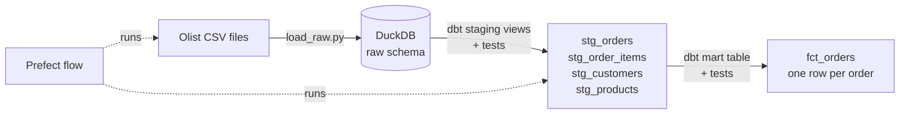

# Olist order-to-decision pipeline

End-to-end analytics on 99,441 real e-commerce orders from Olist, a Brazilian marketplace: from raw CSV files to a tested data warehouse, then to delivery-risk and demand models, inventory decisions and a served API.

**Business question:** Which orders are at risk of arriving late, how much will each product category sell in the coming weeks, and how much stock should be held?

## Status

| Module | Content | Status |
|---|---|---|
| 1. Data pipeline | DuckDB warehouse, dbt models with tests, Prefect orchestration | ✅ Done |
| 2. Models | Late-delivery classifier, weekly demand forecast with prediction intervals | ⏳ Next |
| 3. Inventory simulation | Monte Carlo safety stock and service levels | Planned |
| 4. Experiment analysis | A/B test analysis on a public mobile-game dataset | Planned |
| 5. Serving and monitoring | FastAPI in Docker, drift check, dashboard | Planned |

## Architecture (module 1)



- **Load:** `scripts/load_raw.py` copies the 9 CSV files unchanged into DuckDB's `raw` schema.
- **Transform:** dbt staging models rename columns, set types and fix source spelling errors. The `fct_orders` mart joins orders, customers, items and products into one row per order and defines the late-delivery target.
- **Test:** 18 dbt tests check unique and non-null keys, valid order statuses and referential integrity between items and orders.
- **Orchestrate:** `scripts/pipeline.py` runs load, then build, as one Prefect flow with retries and per-task logs.

## Findings so far

- **8.1% of delivered orders arrived late** (7,826 of 96,470 orders with a delivery date), measured as delivery after the estimated date shown to the customer. The classes are imbalanced, so the model in module 2 is evaluated with precision, recall and PR-AUC, not accuracy.
- **About 3% of orders were never delivered** (shipped, canceled, unavailable and others). They stay in the data but are excluded from the late-delivery target.
- **Repeat buying is rare:** 2,997 of 96,096 customers placed more than one order. Olist creates a new `customer_id` for every order, so customers are counted with `customer_unique_id`. A dbt test documents this as a warning.
- **Coverage:** orders from Sep 2016 to Oct 2018. The first and last months are sparse and will be trimmed for forecasting.

## How to run

Requires Python 3.12 on Windows, macOS or Linux.

```bash
git clone https://github.com/muhammedmufad/olist-order-to-decision.git
cd olist-order-to-decision
python -m venv .venv
# Windows: .\.venv\Scripts\Activate.ps1    macOS/Linux: source .venv/bin/activate
pip install -r requirements.txt
```

1. Download the "Brazilian E-Commerce Public Dataset by Olist" from Kaggle and extract the 9 CSV files into `data/raw/`.
2. Run the full pipeline:

```bash
python scripts/pipeline.py
```

## Project structure

```
├── data/raw/              # Olist CSVs (not in the repo)
├── warehouse/             # DuckDB database file (not in the repo)
├── scripts/
│   ├── load_raw.py        # CSVs into the raw schema
│   └── pipeline.py        # Prefect flow: load, then dbt build
└── dbt/
    └── models/
        ├── staging/       # one cleaned model per source table, with tests
        └── marts/         # fct_orders: one row per order
```

## Data

Brazilian E-Commerce Public Dataset by Olist, published on Kaggle. The data is not redistributed in this repository; see the Kaggle page for its license.

## Limitations

- Package versions in `requirements.txt` are not yet pinned.
- The data covers 2016–2018 and one marketplace, so findings describe that context only.